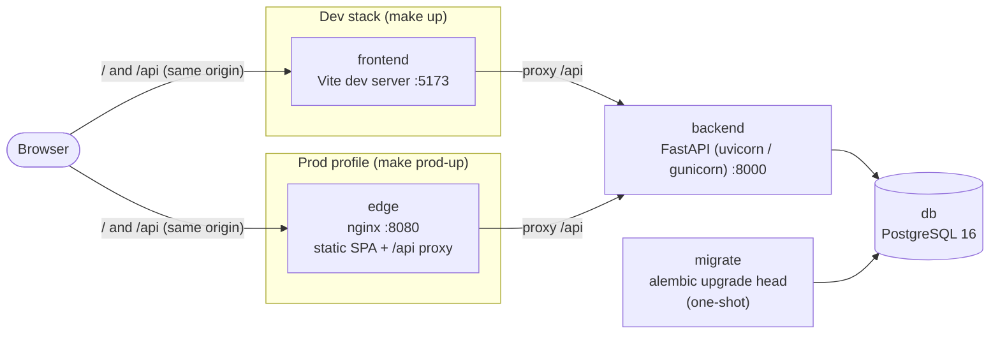

# Architecture

## Containers



Start order: `db` (healthy) → `migrate` (exits 0) → `backend` (healthy) → `frontend` / `edge`.
The browser only ever talks to one origin, so cookies are first-party and CORS is off in production.

## Backend layers

```
app/
  main.py        create_app(): settings → logging → engine → handlers → routers → middleware
  core/          config, logging, request_id, errors, security, middleware, pagination, clock, idempotency
  db/            Base + naming convention, session (one unit of work per request), types, model discovery
  authz/         permission catalogue, Actor, require_permission/require_any, Scope + apply_scope
  platform/      identity, system (settings, counters…), audit, activity, notifications, storage, email, jobs
  modules/<slot> router → service → repository → models  (+ schemas, PARITY.md)
  api/           /api/v1 aggregation, /healthz, /readyz
```

Rules (enforced by import-linter in `make lint`):

- Inside a module: `router → service → repository → models`; never upward, and routers never touch
  repositories or models directly.
- `core`, `db`, `authz` and `platform` never import `modules`, `api` or `main`.

Request pipeline (outermost first): RequestContext (request ID, access log) → SecurityHeaders →
BodySizeLimit → TrustedHost → CORS (dev only, when configured) → CSRF → exception handling → route.

## Frontend

```
src/
  main.tsx, app/      App, providers (Query, Auth, Toast, error boundary), router, route inventory
  styles/globals.css  verbatim pilot tokens (provisional until the pilot is added)
  components/ui       ported primitives
  components/shell    AppLayout, Sidebar, Topbar, nav.ts, public/bare layouts
  features/<slot>     route-specs.ts (data), routes.tsx (lazy routes), api.ts (query hooks), PARITY.md
  lib/                api-client (openapi-fetch + CSRF), query-client, auth-context, permissions, utils
  api/schema.d.ts     GENERATED from /api/v1/openapi.json
```

Three layouts: `app` (signed-in shell), `public` (sign-in card), `bare` (public questionnaire).
Every route is a lazy route object; a feature port swaps the placeholder page for the real one
without touching the router.

## Data

Platform-core tables only (migration `0001_platform_core`): `users`, `roles`, `user_roles`,
`sessions`, `auth_tokens`, `audit_log` (append-only trigger), `activity_events`, `notifications`,
`notification_preferences`, `settings`, `counters`, `saved_views`, `integration_configs`, `job_runs`.
Business tables arrive with their features. See [pilot-parity.md](pilot-parity.md#data-model-to-port).

## Decisions

See [adr/](adr/).
